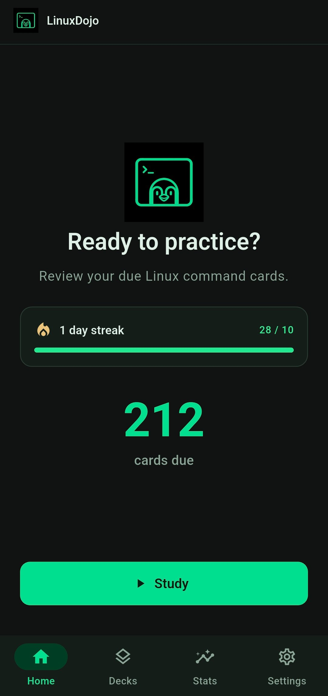
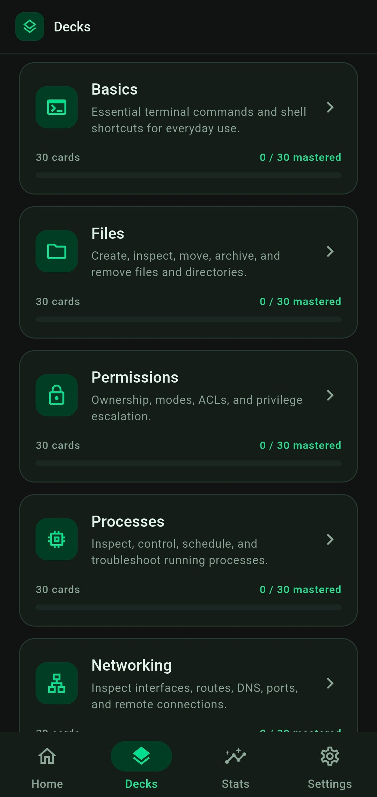
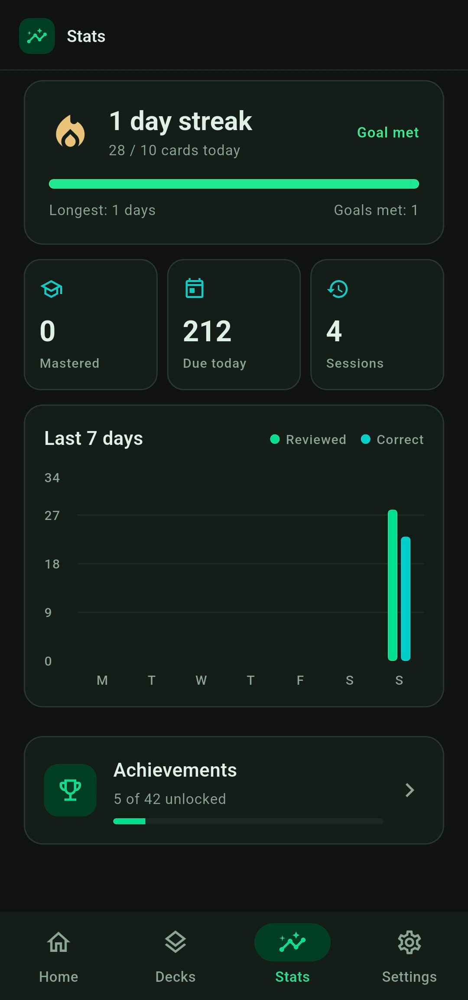

# LinuxDojo

> Learn Linux commands offline, one card at a time.

[](https://github.com/ari/linuxdojo/actions/workflows/ci.yml)
[](LICENSE)
[](https://flutter.dev)

LinuxDojo is a dark-mode, offline-first Flutter app designed to help beginners memorize Linux commands through active recall and spaced repetition. The app focuses on real shell usage, short study sessions, and local-only progress so users can practice without accounts, cloud sync, or internet access.

## Screenshots

<p align="center">
  
  
  
</p>

## Product overview

LinuxDojo is built for people who want to learn Linux command-line basics in a practical, repeatable way. Instead of reading static cheat sheets, users review short, focused flashcards that adapt to memory through a simplified SM-2 algorithm.

The app is intentionally opinionated:
- 100% offline
- dark-only Material 3 interface
- local SQLite persistence
- no account creation or sign-in flow
- terminal-inspired UX with command-focused styling
- mobile-first study workflow for Android and iOS source projects

## Core learning experience

### Study flow
- Sessions are short and focused, built around a daily target
- Each card is selected from a local deck of Linux commands
- Cards are mixed by type instead of being locked to a single session format
- Session composition targets roughly 60% flip cards and 40% multiple choice

### Card types
- Flip cards:
  - prompt is shown first
  - user taps to reveal the answer
  - grades use Again / Hard / Good / Easy
- Multiple choice cards:
  - user picks one of four options
  - immediate feedback is shown
  - correct answers auto-grade as Good
  - wrong answers auto-grade as Again
  - the correct answer always includes a usage example

### Scheduling model
LinuxDojo uses a simplified SM-2-style scheduling system to update:
- ease factor
- repetition count
- interval
- next review date

This keeps review timing personalized while staying lightweight enough for a local-only app.

### Important rules
- Cards involving command arguments or usage patterns are always treated as flip cards
- Correct MC answers show the example immediately
- Wrong MC answers are rescheduled as Again
- Streaks count only when the configured daily goal is met

## Content library

The app ships with 8 fixed decks and 30 cards per deck, for a total of 240 cards.

Decks include:
1. Basics
2. Files
3. Permissions
4. Processes
5. Networking
6. Users & Groups
7. Text Processing
8. System Information

Each deck is curated to mix all difficulty tags and to contain at least 18 flip cards and 12 multiple choice cards. The card JSON assets are stored in `assets/decks/` and are loaded once when the local database is empty.

## Features

- 240 command cards across 8 decks covering essential Linux topics
- offline local learning with no network permissions
- spaced-repetition review engine based on SM-2 principles
- daily study goal and streak logic
- 30+ achievements displayed on a dedicated achievements screen
- weekly stats and activity tracking
- smart local reminders based on recent study patterns, streak, and goal status
- onboarding flow for experience level, daily goals, and reminder configuration
- persistent settings and progress reset controls
- dark-only Material 3 UI with terminal-inspired accents

## Notifications and reminders

LinuxDojo includes a local reminder system designed to nudge users back into study without requiring a server or account.

Behavior includes:
- reminder time derived from recent study patterns and a safe waking window
- reminder auto-skip once the daily goal is already met
- tap-to-open study flow from the notification
- rescheduling after sessions, goal changes, or app resume
- Android re-registration after reboot via local notification scheduling

## App architecture

### Stack
| Layer | Technology |
| --- | --- |
| UI | Flutter 3.47.1 + Material 3 |
| State | Riverpod 3 |
| Persistence | Drift + SQLite |
| Charts | fl_chart |
| Notifications | flutter_local_notifications + timezone |
| Testing | flutter_test + in-memory Drift |
| CI | GitHub Actions |
| Platforms | Android + iOS source |

### Project structure
```text
lib/
├── app/                    # App root, app shell, and app-wide configuration
├── core/
│   ├── database/           # Drift schema, seed loader, providers, migrations
│   ├── models/             # Card types, difficulty tags, shared domain models
│   ├── theme/              # Dark theme, colors, typography, design tokens
│   └── widgets/            # Shared UI components
├── features/
│   ├── decks/              # Deck browsing and deck data access
│   ├── home/               # Daily home and entry point to study
│   ├── notifications/      # Reminder scheduling and notification behavior
│   ├── onboarding/         # First-run setup and initial configuration
│   ├── settings/           # User preferences, reminders, reset actions
│   ├── shell/              # App shell and bottom navigation surface
│   ├── stats/              # Weekly stats and achievements
│   └── study/              # Cards, sessions, review flow, SM-2 logic
├── main.dart               # App bootstrap and provider container creation
└── ...

assets/
├── decks/                  # 8 JSON deck files loaded on first app startup
├── icons/                  # App icon resources
└── ...

test/
├── assets/                 # Asset integrity and deck validation tests
├── features/               # Feature-level tests
├── helpers/                # Shared test utilities for in-memory database setup
└── ...
```

## Local development

### Requirements
- Flutter 3.47.1
- Dart 3.13.1+
- Android Studio / VS Code with Flutter support
- macOS + Xcode for iOS build/test work

### Install dependencies
```bash
flutter pub get
```

### Run the app
```bash
flutter run
```

### Run the analyzer and tests
```bash
flutter analyze
flutter test
```

### Regenerate Drift code after schema changes
```bash
dart run build_runner build
```

### Format code
```bash
dart format lib test
```

## Build and release notes

### Android APK
```bash
flutter build apk --release
```

The APK is produced under the Flutter build output folders, typically in `build/app/outputs/flutter-apk/`.

### iOS
The project includes iOS source support, but actual iOS builds require a macOS environment with Xcode. This repo is not intended to be built for iOS on a Linux host.

## Quality and validation

The project includes automated validation for the content model and app behavior:
- deck asset tests verify there are exactly 8 decks
- each deck has 30 cards
- all difficulty tags are represented
- each deck contains at least 18 flip cards and 12 multiple choice cards
- CI runs `flutter analyze && flutter test`

## License

LinuxDojo is released under the [MIT License](LICENSE).

## Notes

- App package/config: `com.ari.linuxdojo`
- UI is English-only and dark-only by design
- The project is intentionally offline and does not include cloud sync, account management, AI recall, or user-created cards
- This repo is a product-focused MVP and does not include the out-of-scope features defined in the implementation plan
